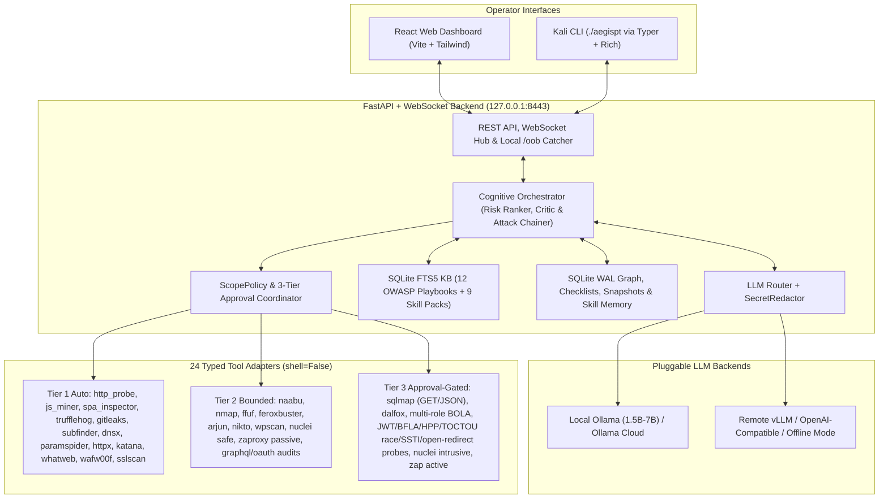
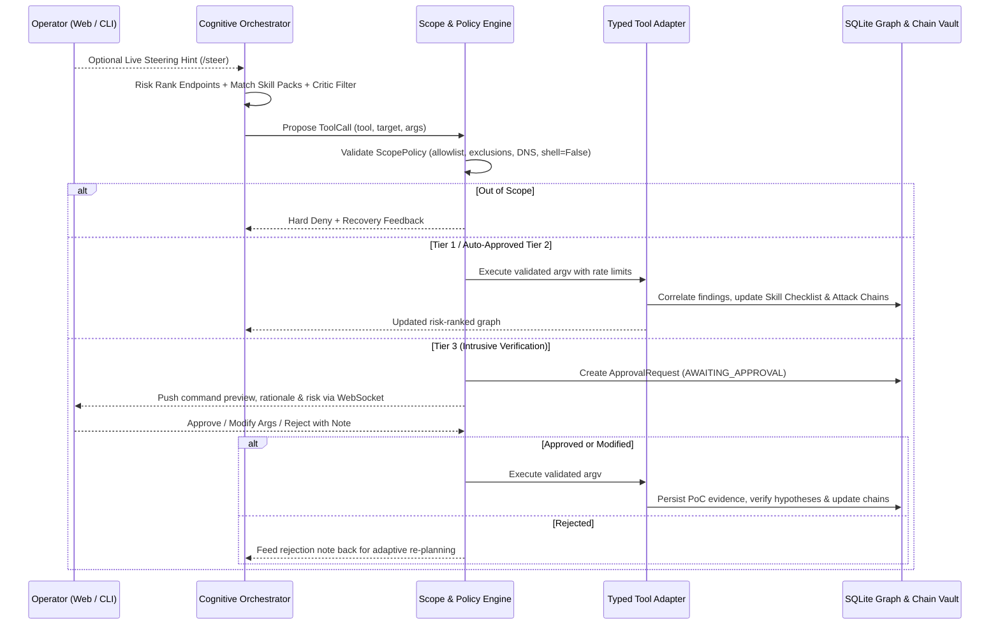

<div align="center">

# AegisPT

### Private, Provider-Agnostic AI Web & API Penetration Testing Platform

Built for Kali Linux with allowlist-only scope enforcement, 3-tier human-in-the-loop approval gates, 24 typed security tool adapters, modular offensive skill packs, and a real-time Web Dashboard + CLI.

[](./.github/workflows/ci.yml)
[](https://www.python.org/)
[](https://fastapi.tiangolo.com/)
[](https://react.dev/)
[](https://www.kali.org/)

[Architecture](#architecture) •
[Autonomy & Guardrails](#autonomy--safety-guardrails) •
[Tooling Matrix](#3-tier-tooling-matrix) •
[Quick Start](#quick-start) •
[API & Config](#configuration--api-reference) •
[Testing & CI](#running-tests--ci)

</div>

---

## Why AegisPT?

| Pillar | What It Does |
| :--- | :--- |
| **Private & Encrypted at Rest** | FastAPI + WebSocket backend binds strictly to `127.0.0.1:8443` with header-based bearer auth (`data/.api_token`, `0600`), single-use browser WebSocket tickets, owner-only `data/` (`0700`), Fernet-encrypted API keys & primary/secondary auth vaults (`data/.master.key`), scrubbed logs, and idempotent SQLite schema auto-migration. |
| **Provider-Agnostic LLM Router** | Hot-swap between **Local Ollama**, **Ollama Cloud (`https://ollama.com`)**, remote **vLLM / OpenAI-compatible** endpoints, or **Zero-LLM Offline mode** (`AEGISPT_LLM_MODE=offline`) with exponential retry, multi-profile failover, `fast` + `reasoning` tiers, and secret redaction on non-local calls. |
| **Cognitive Multi-Skill Brain** | Risk-weighted endpoint prioritizer (query + body params), Self-Critic gating, signal-activated **SQLite FTS5 Knowledge Base** (`12` OWASP WSTG playbooks + `9` modular Skill Packs = `21` modules), Hypothesis Tracking, Cross-Engagement Skill Stats, **Attack-Chain Synthesis**, and **Live Operator Steering** (`steer`). |
| **Non-Bypassable Scope & Multi-Role Auth** | Default-deny `ScopePolicy` enforces normalized port/path allowlists (with URL-decoding & `posixpath` traversal checks), hop-by-hop redirect SSRF guards, DNS boundaries, encrypted **User A vs. User B** credentials for true IDOR/BOLA verification, bounded local `/oob` lab callback catcher, and `shell=False` typed `argv` execution. |
| **Dual Operator Experience** | Operate from the **React Web Dashboard** (Attack Graph, **Chains**, **Skill Checklist**, Endpoints, Findings + **Re-Verify**, interactive **HTTP Repeater**, **Hypotheses**, **OOB Events**, **Scan Diff**, Raw Log Viewer, **Live Steering**, Approval Modal) or **Kali CLI** (`./aegispt` with automatic `latest` engagement resolution). |
| **Developer-Ready Reporting** | One-click exports in **Print-ready HTML/PDF**, **Markdown**, **SARIF 2.1.0**, **JSON**, and shell-safe **`PoC Replay Script (.sh)`** with Posture Score, Synthesized Attack Chains, OWASP breakdown, CVSS v3.1 scores, PoC commands, and remediation guidance. |

---

## Architecture



---

## Autonomy & Safety Guardrails

AegisPT supports three operator-selectable execution modes per engagement:

- **`tiered`** *(Default)* — Runs Tier 1 recon and bounded Tier 2 scans automatically; pauses and prompts the operator (Web modal or CLI `[a]pprove / [e]dit / [r]eject`) before every Tier 3 active verification action.
- **`copilot`** — Prompts operator approval before every tool execution across all tiers.
- **`lab_autopilot`** — Unattended end-to-end execution strictly for isolated localhost/Docker practice labs.



---

## 3-Tier Tooling Matrix

| Tool | Default Tier | Escalation Rule | Capability |
| :--- | :---: | :--- | :--- |
| `http_probe` | **Tier 1** | **Tier 2** on `graphql_deep_audit`, `oauth_audit`; **Tier 3** on `replay_request`, `differential_bola`, `jwt_active_probe`, `bfla_verb_tamper`, `race_burst_probe`, `hpp_and_content_switch`, `ssti_probe`, `open_redirect_probe`, or mutating HTTP methods | Native async HTTP/TLS/header/CORS-matrix/cookie/JWT/OpenAPI analyzer, GraphQL oracle & schema importer, OAuth/OIDC auditor, multi-role BOLA/IDOR, verb BFLA, TOCTOU concurrency burst, HPP/content-type, SSTI family & open-redirect checks |
| `js_miner` | **Tier 1** | — | Mines in-scope JS bundles & `.js.map` source maps for hidden API routes, JSON `body_params`, DOM sink indicators & masked secrets |
| `spa_inspector` | **Tier 1** | — | Scope-locked Playwright headless Chromium inspector capturing SPA XHR/Fetch requests, JSON payloads, and `localStorage`/`sessionStorage` JWTs |
| `trufflehog` | **Tier 1** | — | Offline TruffleHog scan across fetched in-scope HTML/JS artifacts for leaked credentials (`--no-verification` by default) |
| `gitleaks` | **Tier 1** | — | Offline Gitleaks rule scan across fetched target artifacts (`--redact=100`) |
| `subfinder` | **Tier 1** | — | Passive subdomain enumeration |
| `dnsx` | **Tier 1** | — | DNS A/AAAA/CNAME/MX/TXT resolution & SPF/DMARC posture checks |
| `paramspider` | **Tier 1** | — | Historical parameterized URL mining scoped strictly to allowlisted domains |
| `httpx` | **Tier 1** | — | Live HTTP probing (ProjectDiscovery `httpx` with automatic native `http_probe` fallback) |
| `katana` | **Tier 1** | — | Web & JavaScript route/parameter crawling |
| `whatweb` | **Tier 1** | — | Server, CMS, and framework fingerprinting |
| `wafw00f` | **Tier 1** | — | WAF / CDN detection |
| `sslscan` | **Tier 1** | — | TLS protocol, weak cipher suite, and certificate validity auditor |
| `naabu` | **Tier 2** | Configurable (`tier2_auto`) | Fast unprivileged TCP connect port scan |
| `nmap` | **Tier 2** | Configurable (`tier2_auto`) | Bounded TCP port & service version scan (`-sT -Pn --top-ports`) |
| `ffuf` | **Tier 2** | Configurable (`tier2_auto`) | Rate-limited directory & API discovery with auto-calibration |
| `feroxbuster` | **Tier 2** | Configurable (`tier2_auto`) | Bounded recursive directory & content discovery |
| `arjun` | **Tier 2** | Configurable (`tier2_auto`) | HTTP query, form, and JSON parameter mining |
| `nikto` | **Tier 2** | Configurable (`tier2_auto`) | Bounded web server misconfiguration & dangerous file checks |
| `wpscan` | **Tier 2** | Triggered conditionally on WordPress | WordPress plugin, theme, user, and configuration vulnerability scanner (`--no-update`) |
| `nuclei` | **Tier 2** | Tier 3 when `include_intrusive=true` or `fuzz`/`intrusive` tags | Template scanner (Tier 2 excludes `dos,intrusive,fuzz,bruteforce`) |
| `zaproxy` | **Tier 2** | Tier 3 in `active_scan` mode | OWASP ZAP headless daemon spider/passive alerts & active scan |
| `dalfox` | **Tier 3** | Always gated in `tiered` mode | Cross-Site Scripting (XSS) parameter verification |
| `sqlmap` | **Tier 3** | Always gated in `tiered` mode | Bounded SQL injection verification (`--batch`, `level<=2`, `risk<=2`, GET/POST/PUT/PATCH with auto JSON `Content-Type`) |

---

## Quick Start

### 1. Clone, Configure & Run Diagnostics

```bash
git clone https://github.com/willygailo/AI-ko.git
cd AI-ko/aegispt
cp .env.example .env

# Guided .env setup wizard (Ollama Cloud, Local Ollama, or Zero-LLM Offline mode)
./aegispt setup

# Verify all 24 Kali & native adapters, 21 KB playbooks/skills, and active LLM reachability
./aegispt doctor        # Add --json for machine-readable output

# Browse the interactive cheat sheet for all 24 tools & 12 http_probe modes
./aegispt tools         # Optional: --tier 1 | 2 | 3
```

<details>
<summary>Optional: Install <code>aegispt</code> Globally & Enable Shell Completion</summary>

The [`./aegispt`](./aegispt/aegispt) launcher works out of the box from `aegispt/` without installing anything globally. To invoke `aegispt` or `python -m aegispt_cli.main` from any directory and enable shell completion:

```bash
cd aegispt
pip install --user --break-system-packages --no-build-isolation --no-deps -e .
aegispt --install-completion
```

</details>

> [!TIP]
> **Local Ollama, Ollama Cloud, or Offline Mode**:
> - **Local Ollama (`./scripts/setup_ollama.sh`)**:
>   - Default `--light` profile pulls `qwen2.5:1.5b` + `qwen2.5:3b` (~2.5 GB, ideal for 7.5–8 GB RAM hosts).
>   - Pass `--coder` (`./scripts/setup_ollama.sh --coder`) on hosts with 12+ GB RAM to pull `qwen2.5:3b` + `qwen2.5-coder:7b` (~6.5 GB).
> - **Ollama Cloud**: Run `./aegispt setup --provider cloud` (or set `AEGISPT_OLLAMA_URL=https://ollama.com` + `AEGISPT_OLLAMA_API_KEY`) — or click the **Ollama Cloud** preset inside the Web Dashboard Settings modal.
> - **Offline Mode**: Run `./aegispt setup --provider offline` to set `AEGISPT_LLM_MODE=offline` and run deterministic OWASP + Skill Pack planning with zero outbound LLM requests.

### 2. Start the Backend & Web Dashboard

```bash
./aegispt serve
```

- Web Dashboard & API listen on `http://127.0.0.1:8443` (honoring `AEGISPT_HOST`/`AEGISPT_PORT` from `.env`, and serving `aegispt/frontend/dist` automatically when built).
- Startup logs keep the raw bearer token masked by default (`AEGISPT_PRINT_TOKEN=0`); retrieve it anytime with `./aegispt token`.
- Dashboard tabs include **Attack Graph**, **Chains** (synthesized multi-step attack paths), **Skills** (checklist coverage matrix), **Endpoints**, **Findings** (`Confirm`, `False Positive`, **Re-Verify**, `Send to Repeater`, and HTML/Markdown/SARIF/JSON/`PoC .sh` exports), **Hypotheses**, **Repeater**, **Runs**, **Approvals**, **OOB Events**, and **Diff**, plus the **Live Steering** bar and **Multi-Role Auth Vault** (`+ New`).

<details>
<summary>Frontend Build & Hot-Reload Development Commands</summary>

```bash
cd aegispt/frontend
pnpm install --frozen-lockfile
pnpm typecheck && pnpm lint && pnpm test && pnpm build   # Builds dist/ served by FastAPI on :8443
pnpm dev                                                 # Optional Vite dev server on :5173
```

Or run both backend and frontend dev servers together from the repo root with `make dev`.

</details>

### 3. Try It Against a Local Test Lab (OWASP Juice Shop)

Spin up the isolated localhost-only (`127.0.0.1:3000`) practice container:

```bash
cd aegispt
docker compose -f lab/docker-compose.lab.yml up -d
```

Create a scoped engagement (using `--url`, optional `--domain` for host/subdomains, and optional `-H` / `--secondary-header` for multi-role IDOR checks), control its lifecycle, steer the AI brain, and export reports (`latest` engagement ID is used automatically when omitted):

```bash
# 1. Create scoped engagement (local URL and/or custom test-lab domain)
./aegispt engagement create \
  --name "Local Juice Shop" \
  --url http://127.0.0.1:3000 \
  --allow-private-ips \
  --mode tiered

# 2. Optional: guide the AI brain toward specific features mid-assessment
./aegispt steer "Focus on GraphQL, JWT alg=none, and multi-role BOLA checks"

# 3. Start & stream live progress + Tier-3 [a]pprove/[e]dit/[r]eject prompts
./aegispt run

# 4. Lifecycle control, re-attach, manual tool runs & governance
./aegispt pause
./aegispt resume
./aegispt attach
./aegispt stop
./aegispt run-tool http_probe http://127.0.0.1:3000 --args '{"mode":"passive_audit"}'
./aegispt approvals
./aegispt snapshots
./aegispt llm-profiles

# 5. Inspect runs, hypotheses, skill coverage, attack chains, findings & deltas
./aegispt runs
./aegispt hypotheses
./aegispt checklist
./aegispt chains
./aegispt findings
./aegispt diff
./aegispt repeat latest http://127.0.0.1:3000/api/Products

# 6. Export HTML/JSON reports & shell-safe PoC replay script
./aegispt report --format html --out report.html
./aegispt report --format json --out report.json
./aegispt report --format poc_sh --out verify_findings.sh
```

---

## Configuration & API Reference

<details>
<summary><strong>Repository Structure</strong></summary>

```text
.
├── .github/
│   ├── PULL_REQUEST_TEMPLATE.md
│   └── workflows/ci.yml                # GitHub Actions CI (backend, frontend, security)
├── .gitignore
├── .pre-commit-config.yaml             # Ruff + pre-commit hygiene & private-key hooks
├── Makefile                            # Root DevEx entrypoints (check, lint, test, build-ui, dev)
├── README.md
├── CONTRIBUTING.md / CODE_OF_CONDUCT.md / SECURITY.md
└── aegispt/
    ├── aegispt                         # CLI launcher script (./aegispt)
    ├── pyproject.toml                  # Python project, extras & entrypoint metadata
    ├── .env.example                    # Complete environment configuration template
    ├── README.md                       # Subproject Quick Start
    ├── TOOLS_AND_SETUP.md              # AI backend setup & 24-tool operator guide
    ├── backend/
    │   ├── app/
    │   │   ├── main.py                 # FastAPI app, lifespan, OOB & static mount
    │   │   ├── config.py               # Pydantic settings (AEGISPT_*)
    │   │   ├── core/                   # auth, scope, policy, redactor, vault, ratelimit, events
    │   │   ├── db/                     # Async SQLite + auto-migration, ORM models, persistence & snapshots
    │   │   ├── llm/                    # Ollama (Local/Cloud) & OpenAI-compat router with retry & failover
    │   │   ├── tools/                  # 24 typed Kali, Playwright SPA & native security adapters
    │   │   ├── knowledge/              # 12 WSTG playbooks + 9 Markdown Skill Packs (SQLite FTS5)
    │   │   ├── agents/                 # Cognitive orchestrator, risk graph ranker, chainer & reporter
    │   │   └── api/                    # REST routers, OOB catcher, Repeater & WebSocket handler
    │   └── tests/                      # Automated backend, security & CLI pytest suite
    ├── cli/aegispt_cli/                # Typer + Rich CLI client
    ├── frontend/                       # React + Vite + TypeScript + Tailwind UI & tests
    ├── lab/docker-compose.lab.yml      # Localhost-only hardened OWASP Juice Shop target
    └── scripts/setup_ollama.sh         # Optional local Ollama model pull helper (--light / --coder)
```

</details>

<details>
<summary><strong>Environment Variables (<code>aegispt/.env</code>)</strong></summary>

| Variable | Default | Description |
| :--- | :--- | :--- |
| `AEGISPT_HOST` | `127.0.0.1` | Bind address for FastAPI server (see [SECURITY.md](./SECURITY.md) before changing) |
| `AEGISPT_PORT` | `8443` | HTTP / WebSocket server port |
| `AEGISPT_SERVER_URL` | `""` | Optional CLI override when targeting a non-default server URL |
| `AEGISPT_API_TOKEN` | _(auto-generated)_ | Fixed bearer token; if blank, created atomically (`0600`) in `data/.api_token` |
| `AEGISPT_PRINT_TOKEN` | `0` | Set to `1` to print the raw bearer token on `./aegispt serve` startup (default `0` hides it; use `./aegispt token`) |
| `AEGISPT_DATA_DIR` | `./data` | Storage directory (`0700`) for SQLite DBs, vault keys, logs, and tool artifacts |
| `AEGISPT_LLM_MODE` | `auto` | LLM mode: `auto` (use configured provider) or `offline` (disable all outbound LLM calls) |
| `AEGISPT_OLLAMA_URL` | `http://127.0.0.1:11434` | Local Ollama or Ollama Cloud (`https://ollama.com`) endpoint |
| `AEGISPT_OLLAMA_API_KEY` | `""` | Optional Bearer API key for authenticated / cloud Ollama endpoints |
| `AEGISPT_OLLAMA_FAST_MODEL` | `qwen2.5:3b` | Fast parser / extraction model (`qwen2.5:1.5b` under `--light`) |
| `AEGISPT_OLLAMA_REASONING_MODEL` | `qwen2.5-coder:7b` | Primary planning & triage model (`qwen2.5:3b` under `--light`) |
| `AEGISPT_REMOTE_LLM_URL` | `""` | Optional remote OpenAI-compatible / vLLM endpoint |
| `AEGISPT_REMOTE_LLM_API_KEY` | `""` | Bearer API key for remote OpenAI-compatible LLM endpoint |
| `AEGISPT_REMOTE_FAST_MODEL` | `""` | Fast model ID for remote OpenAI-compatible endpoint |
| `AEGISPT_REMOTE_REASONING_MODEL` | `""` | Reasoning model ID for remote OpenAI-compatible endpoint |
| `AEGISPT_REDACT_OUTBOUND` | `true` | Masks tokens, cookies, API keys, JWTs, and private keys before non-local LLM calls |
| `AEGISPT_ZAP_URL` | `http://127.0.0.1:8080` | Optional OWASP ZAP headless daemon API URL |
| `AEGISPT_ZAP_API_KEY` | `""` | Optional API key for OWASP ZAP daemon |
| `AEGISPT_DEFAULT_TOOL_TIMEOUT` | `180` | Subprocess execution timeout (seconds) |
| `AEGISPT_MAX_OUTPUT_BYTES` | `2097152` | Maximum captured stdout/stderr bytes per tool execution (2 MiB) |
| `AEGISPT_DEFAULT_MAX_STEPS` | `25` | Default maximum orchestrator iterations per engagement |
| `AEGISPT_APPROVAL_TIMEOUT_SECONDS` | `3600` | Timeout (seconds) before pending Tier-3 approval requests expire |

</details>

<details>
<summary><strong>Authentication & REST / WebSocket Endpoints</strong></summary>

- **REST Authentication**: All `/api/v1/*` routes (except `/api/v1/system/health` and the lab `/oob/*` callback catcher) require header authentication via `Authorization: Bearer <token>` (or `X-API-Key: <token>`). Query-parameter `?token=` authentication is disabled on REST endpoints to prevent secret leakage in access logs and browser history.
- **WebSocket Authentication**: `WS /ws/engagements/{id}` accepts `Authorization: Bearer <token>` headers (used by the CLI and API clients) or a short-lived, single-use `?ticket=<ticket>` issued by `POST /api/v1/system/ws-ticket` (used by the React Web Dashboard).

| Group | Endpoints |
| :--- | :--- |
| **System, Auth & KB** | `GET /api/v1/system/health`, `GET /api/v1/system/doctor`, `GET /api/v1/system/tools`, `GET /api/v1/system/kb/search`, `POST /api/v1/system/ws-ticket` |
| **LLM Profiles** | `GET/POST /api/v1/llm-profiles`, `POST /api/v1/llm-profiles/{id}/default`, `DELETE /api/v1/llm-profiles/{id}`, `POST /api/v1/llm-profiles/discover` |
| **Engagements & Steering** | `GET/POST /api/v1/engagements`, `GET/DELETE /api/v1/engagements/{id}`, `POST /api/v1/engagements/{id}/{start\|pause\|resume\|stop\|steer\|run-tool\|repeater\|snapshots\|chains/synthesize}`, `GET /api/v1/engagements/{id}/diff`, `GET /api/v1/engagements/{id}/runs/{run_id}/log` |
| **Local Lab OOB** | `ANY /oob/{engagement_id}/{token}`, `GET /api/v1/engagements/{id}/oob` |
| **Approvals, Hypotheses & Findings** | `GET /api/v1/engagements/{id}/approvals`, `POST /api/v1/approvals/{approval_id}/decide`, `GET /api/v1/engagements/{id}/hypotheses`, `PATCH /api/v1/hypotheses/{id}`, `GET/POST /api/v1/engagements/{id}/findings`, `PATCH /api/v1/findings/{finding_id}`, `POST /api/v1/findings/{finding_id}/reverify` |
| **Reports & Stream** | `GET /api/v1/engagements/{id}/report?format=html\|markdown\|sarif\|json\|poc_sh`, `WS /ws/engagements/{id}` (`Authorization: Bearer` header or `?ticket=<single-use-ticket>`) |

</details>

---

## Running Tests & CI

Run the full CI-equivalent verification suite (Ruff, pytest, ShellCheck, frontend typecheck/lint/tests/build, and Docker Compose validation) from the repository root:

```bash
make check
```

Or run individual test suites:

```bash
# Backend & CLI lint + automated tests
cd aegispt && ruff check backend cli && pytest -v

# Frontend typecheck, lint, unit tests, and production build
cd aegispt/frontend && pnpm typecheck && pnpm lint && pnpm test && pnpm build
```

Automated CI (`.github/workflows/ci.yml`) runs on every push to `main` and pull request, verifying scope allowlists & DNS boundary checks, security hardening regressions, SQLite persistence & schema migration, 3-tier approval workflows, all 24 tool adapters/native probes, LLM routing + failover + secret redaction, attack-chain synthesis, CLI commands, REST/WebSocket auth, frontend unit tests/build, shell scripts, and secret scanning.

---

## Contributing & Contributors

Contributions are welcome! Please read [CONTRIBUTING.md](./CONTRIBUTING.md), [CODE_OF_CONDUCT.md](./CODE_OF_CONDUCT.md), and [SECURITY.md](./SECURITY.md) before opening a pull request.

<table>
  <tr>
    <td align="center">
      <a href="https://github.com/willygailo">
        <br />
        <sub><b>@willygailo</b></sub>
      </a><br />
      <sub>Creator &amp; Lead Maintainer</sub>
    </td>
  </tr>
</table>

View full commit history on [GitHub Contributors](https://github.com/willygailo/AI-ko/graphs/contributors).

---

> [!WARNING]
> **Authorized Use Only**: AegisPT is intended strictly for authorized security assessments, defensive hardening, and isolated lab testing. Always obtain explicit written authorization and configure strict scope allowlists before testing any system.
