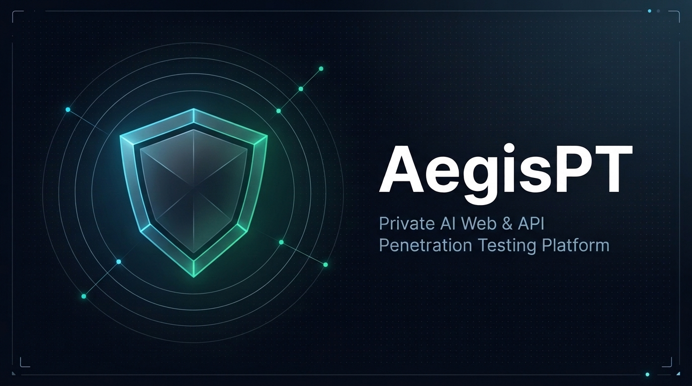
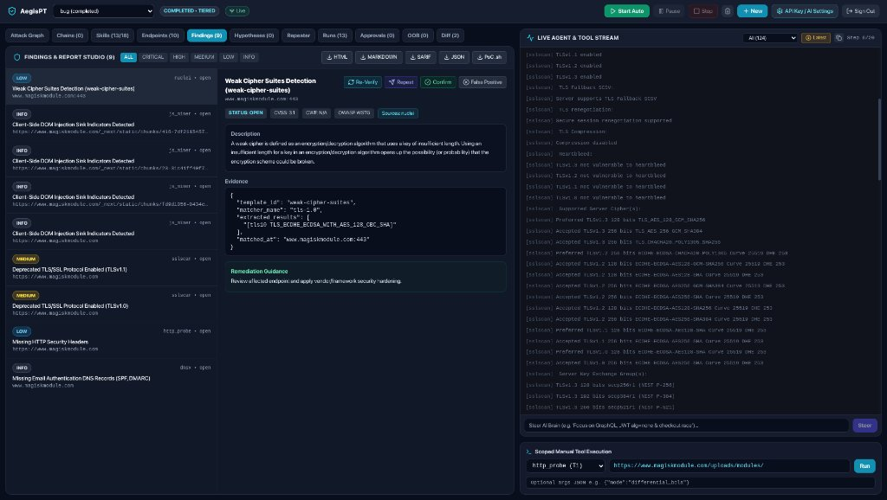
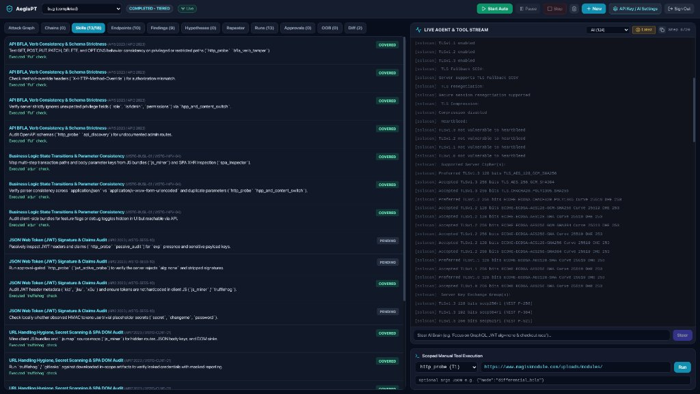
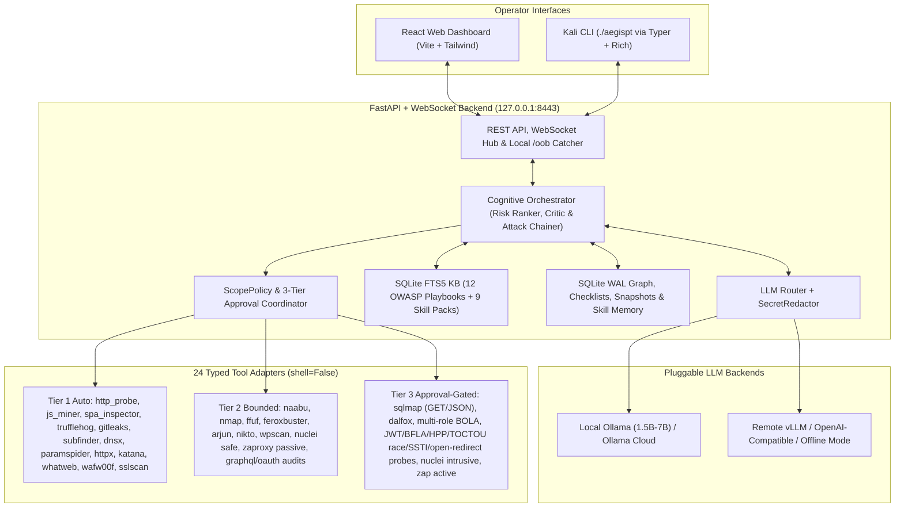
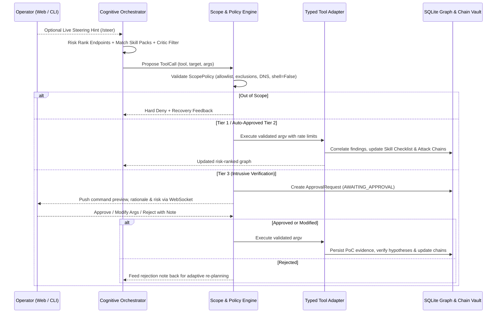

<div align="center">



<br />

# AegisPT

### Private, Provider-Agnostic AI Web & API Penetration Testing Platform

Built for Kali Linux with allowlist-only scope enforcement, 3-tier human-in-the-loop approval gates, 24 typed security tool adapters, modular offensive skill packs, and a real-time Web Dashboard + CLI.

[](https://github.com/willygailo/AI-ko/actions/workflows/ci.yml)
[](https://www.python.org/)
[](https://fastapi.tiangolo.com/)
[](https://react.dev/)
[](https://www.kali.org/)

[Screenshots](#web-dashboard-preview) •
[How to Set Up](#how-to-set-up) •
[How to Use](#how-to-use) •
[Architecture](#architecture) •
[Autonomy & Guardrails](#autonomy--safety-guardrails) •
[Tooling Matrix](#3-tier-tooling-matrix) •
[API & Config](#configuration--api-reference) •
[Testing & CI](#running-tests--ci)

</div>

---

## Web Dashboard Preview

<div align="center">

### Interactive Attack-Surface Graph &amp; Live Agent Stream


<br /><br />

### Findings &amp; Report Studio (Re-Verify, Repeater Pivot &amp; 1-Click Exports)


<br /><br />

<table>
  <tr>
    <td width="50%" align="center">
      <b>Offensive Skill Methodology Checklist (13/18 Covered)</b><br /><br />
      
    </td>
    <td width="50%" align="center">
      <b>Scoped Engagement Wizard &amp; Lab Preset</b><br /><br />
      
    </td>
  </tr>
</table>

<details>
<summary>View Initial Scoped Workspace (Idle State Before Assessment)</summary>
<br />

</details>

</div>

---

## Why AegisPT?

| Pillar | What It Does |
| :--- | :--- |
| **Private & Encrypted at Rest** | FastAPI + WebSocket backend binds strictly to `127.0.0.1:8443` with header-based bearer auth (`data/.api_token`, `0600`), single-use browser WebSocket tickets, owner-only `data/` (`0700`), Fernet-encrypted API keys & primary/secondary auth vaults (`data/.master.key`), scrubbed logs, and idempotent SQLite schema auto-migration. |
| **Provider-Agnostic LLM Router** | Hot-swap between **Local Ollama**, **Ollama Cloud (`https://ollama.com`)**, remote **vLLM / OpenAI-compatible** endpoints, or **Zero-LLM Offline mode** (`AEGISPT_LLM_MODE=offline`) with exponential retry, multi-profile failover, `fast` + `reasoning` tiers, and secret redaction on non-local calls. |
| **Cognitive Multi-Skill Brain** | Risk-weighted endpoint prioritizer (query + body params), Self-Critic gating, signal-activated **SQLite FTS5 Knowledge Base** (`12` OWASP WSTG playbooks + `9` modular Skill Packs = `21` modules), Hypothesis Tracking, Cross-Engagement Skill Stats, **Attack-Chain Synthesis**, and **Live Operator Steering** (`steer`). |
| **Non-Bypassable Scope & Multi-Role Auth** | Default-deny `ScopePolicy` enforces normalized port/path allowlists (with URL-decoding & `posixpath` traversal checks), hop-by-hop redirect SSRF guards, DNS boundaries, encrypted **User A vs. User B** credentials for true IDOR/BOLA verification, bounded local `/oob` lab callback catcher, and `shell=False` typed `argv` execution. |
| **Dual Operator Experience** | Operate from the **React Web Dashboard** (Attack Graph, **Chains**, **Skill Checklist**, Endpoints, Findings + **Re-Verify**, interactive **HTTP Repeater**, **Hypotheses**, **OOB Events**, **Scan Diff**, Raw Log Viewer, **Live Steering**, Approval Modal) or **Kali CLI** (`./aegispt` with automatic `latest` engagement resolution). |
| **Developer-Ready Reporting** | One-click exports in **Print-ready HTML/PDF**, **Markdown**, **SARIF 2.1.0**, **JSON**, and shell-safe **`PoC Replay Script (.sh)`** with Posture Score, Synthesized Attack Chains, OWASP breakdown, CVSS v3.1 scores, PoC commands, and remediation guidance. |

---

## How to Set Up

> [!IMPORTANT]
> **60-Second Copy-Paste Quick Start (All-in-One)**
> Run this single block to clone, install, build the Web UI, and start AegisPT:
> ```bash
> git clone https://github.com/willygailo/AI-ko.git
> cd AI-ko/aegispt
>
> # 1. Create Python virtualenv & install backend + CLI
> python3 -m venv .venv
> .venv/bin/pip install --upgrade pip && .venv/bin/pip install -e ".[dev]"
>
> # 2. Build the React Web Dashboard
> cd frontend && pnpm install --frozen-lockfile && pnpm build && cd ..
>
> # 3. Start AegisPT (prints the Web URL & your copy-pasteable token immediately!)
> ./aegispt serve
> ```
> You will immediately see in your terminal:
> ```text
> [AegisPT] Web Dashboard: http://127.0.0.1:8443
> [AegisPT] Copy & paste this Local API Token into the Web Dashboard:
> aegis_xxxxxxxxxxxxxxxxxxxxxxxxxxxxxxxxxxxxxxxxxxx
> ```
> Copy the `aegis_...` line → open **`http://127.0.0.1:8443`** → paste it → click **`API Key / AI Settings`** in the top-right to paste your AI API key!

### Prerequisites

| Requirement | Needed For | Notes |
| :--- | :--- | :--- |
| **Linux / Kali Linux** | Core platform & CLI | Built-in `http_probe`, `js_miner`, and core scanners work anywhere; Kali provides the external CLI binaries (`nmap`, `ffuf`, `nuclei`, `sqlmap`, `dalfox`, etc.) |
| **Python 3.11+** | Backend & CLI | Required (`python3 -m venv` recommended on clean systems) |
| **Node.js 24+ & `pnpm` 11+** | Building the Web UI | Only needed when building or developing `aegispt/frontend` |
| **Docker + Compose** *(Optional)* | Practice lab | For running the isolated localhost-only OWASP Juice Shop lab (`127.0.0.1:3000`) |
| **LLM Provider** *(Optional)* | AI planning & triage | **Ollama Cloud**, **Local Ollama**, **OpenAI-compatible / vLLM**, or **Zero-LLM Offline mode** |

### Step 1: Clone the Repository & Install Python Dependencies

```bash
git clone https://github.com/willygailo/AI-ko.git
cd AI-ko/aegispt

# Create an isolated virtualenv (recommended — ./aegispt detects .venv automatically)
python3 -m venv .venv
.venv/bin/pip install --upgrade pip
.venv/bin/pip install -e ".[dev]"
```

<details>
<summary>Optional: Enable Playwright SPA Inspector &amp; Shell Tab Completion</summary>

```bash
# Enable headless Chromium SPA inspection (`spa_inspector`)
.venv/bin/pip install -e ".[spa]"
.venv/bin/playwright install chromium

# Enable CLI tab completion for bash/zsh/fish
./aegispt --install-completion
```

The [`./aegispt`](./aegispt/aegispt) launcher automatically prefers `aegispt/.venv/bin/python3` when present and works even when symlinked (for example, `sudo ln -s "$PWD/aegispt" /usr/local/bin/aegispt`).

</details>

### Step 2: Build the Web Dashboard UI

```bash
cd frontend
pnpm install --frozen-lockfile
pnpm build
cd ..
```

This builds `aegispt/frontend/dist/`, which the FastAPI server mounts automatically at `http://127.0.0.1:8443`.

### Step 3: Configure Your AI Provider (Web UI or Optional `.env` Wizard)

> [!TIP]
> **Easiest Way (Inside the Web Dashboard)**: You don't need to edit `.env` manually—just run `./aegispt serve`, sign in at `http://127.0.0.1:8443`, and click **`API Key / AI Settings`** in the top bar to paste your **Ollama Cloud** (or OpenAI-compatible) API key.

If you prefer configuring via the terminal before starting the server:

```bash
cp .env.example .env
./aegispt setup
```

- At the `Choose mode` prompt, you can press **`Enter`** (or type **`1`** for `cloud`, **`2`** for `local`, **`3`** for `offline`)—**or simply paste your Ollama Cloud API key directly** and AegisPT will auto-detect `cloud` mode and save your `.env` (`chmod 600`) in one step!
- You can also run non-interactively:
  - **Ollama Cloud (0 MB local RAM)**:
    ```bash
    ./aegispt setup --provider cloud
    ```
  - **Local Ollama (100% offline on your machine)**:
    ```bash
    # Default --light profile: qwen2.5:1.5b + qwen2.5:3b (~2.5 GB, ideal for 7.5–8 GB RAM)
    ./scripts/setup_ollama.sh

    # Or --coder profile for 12+ GB RAM: qwen2.5:3b + qwen2.5-coder:7b (~6.5 GB)
    ./scripts/setup_ollama.sh --coder

    ./aegispt setup --provider local
    ```
  - **Zero-LLM Offline Mode (no AI backend required)**:
    ```bash
    ./aegispt setup --provider offline
    ```

### Step 4: Verify Your Environment

```bash
# Check all 24 tool adapters, 21 KB playbooks/skills, and LLM reachability
./aegispt doctor        # Add --json for machine-readable output

# Browse all 24 tools & 12 native http_probe modes with example arguments
./aegispt tools         # Optional: --tier 1 | 2 | 3
```

---

## How to Use

### 1. Start AegisPT (One Command — Prints Your Token Automatically)

```bash
cd aegispt
./aegispt serve
```

- Starts the Web Dashboard & REST/WebSocket API on **`http://127.0.0.1:8443`** and **immediately prints your copy-pasteable `aegis_...` Local API Token** right in the terminal (no second terminal needed!).
- Copy the printed `aegis_...` token line and open **`http://127.0.0.1:8443`** in your browser.
- *(Tip: You can also run `./aegispt token` or `./aegispt token --raw` anytime if you ever need to retrieve the token separately, or pass `./aegispt serve --hide-token` to suppress printing it on startup.)*

---

### 2. Option A — Visual Step-by-Step Web Dashboard Guide (`http://127.0.0.1:8443`)

#### Step A1: Sign In & Add Your AI API Key
1. Open **`http://127.0.0.1:8443`** in your browser and confirm the green **`Engine Online`** badge is visible on the login card.
2. Click **`Paste from Clipboard`** (or press `Ctrl+V` inside the token input box) to paste the `aegis_...` token printed by `./aegispt serve`, then click **`Connect to Local Engine`**.
3. Once inside the dashboard, click **`API Key / AI Settings`** in the top-right header bar, paste your **Ollama Cloud** (or OpenAI-compatible) API key into the **API Key** field, and click **`Save LLM Profile`**.

---

#### Step A2: Create a Scoped Engagement (`+ New`)
1. Click the cyan **`+ New`** button in the top-right header to open the **New Scoped Engagement** wizard.
2. Enter an **Engagement Name** and your authorized **Allowlisted URLs** or **Allowlisted Domains** (or click **`Load Juice Shop Lab Preset`** in the top-right of the modal for local Docker practice).
3. Configure optional **Allowlisted CIDRs**, **Excluded Hosts**, **Excluded Paths** (e.g., `/logout`, `/billing`), **Autonomy Mode** (`Tiered Autonomy (Recommended)`), and optional **Auth Headers & Session Cookies**, then click **`Create Engagement`**.

<div align="center">
  
</div>

---

#### Step A3: Review Your Scoped Workspace & Click `▶ Start Auto`
1. After creating the engagement, the workspace opens in **`IDLE • TIERED`** state with your scope root node visible in the **Attack-Surface Graph**.
2. Click the green **`▶ Start Auto`** button in the top header to launch the autonomous assessment (or use **`Scoped Manual Tool Execution`** in the bottom-right panel to run a single tool like `http_probe` on demand).

<div align="center">
  
</div>

---

#### Step A4: Monitor the Live Attack Graph, Agent Stream & Steer the AI
1. **Left Pane (`Attack Graph` Tab)**: Watch discovered domains/hosts, HTTP endpoints (`GET /admin`, `GET /api/`, `GET /login`, etc.), and severity-coded findings connect in real time. Click any node to filter or pivot its URL directly into the manual runner or HTTP Repeater.
2. **Right Pane (`Live Agent & Tool Stream`)**: Follow live stdout/telemetry from every tool (`ffuf`, `trufflehog`, `nuclei`, `sslscan`, `http_probe`) and planner decision.
3. **Mid-Run Steering & Approvals**: Type hints into the **`Steer AI Brain`** bar at the bottom-right anytime, and approve/edit/reject any **Tier 3** intrusive checks when the **Approval Modal** pops up.

<div align="center">
  
</div>

---

#### Step A5: Track OWASP WSTG & API Security Skill Coverage (`Skills` Tab)
1. Click the **`Skills`** tab to inspect the live methodology checklist (e.g., **API BFLA**, **Business Logic State Transitions**, **JWT Signature & Claims Audit**, **URL Handling & SPA DOM Audit**).
2. Each checklist item transitions from `PENDING` to `COVERED` automatically with an execution evidence note as matching tools finish.

<div align="center">
  
</div>

---

#### Step A6: Triage Findings, Re-Verify, Replay & Export Reports (`Findings` Tab)
1. Click the **`Findings`** tab to filter discovered vulnerabilities by severity (`ALL`, `CRITICAL`, `HIGH`, `MEDIUM`, `LOW`, `INFO`) and inspect CVSS v3.1, CWE, OWASP WSTG category, JSON evidence, and remediation guidance.
2. Use the action buttons on any finding:
   - **`Re-Verify`**: Re-runs a targeted check to confirm whether a vulnerability is still present or remediated.
   - **`Repeat`**: Sends the finding's target URL straight to the interactive **HTTP Repeater** tab.
   - **`Confirm` / `False Positive`**: Updates the finding's triage status immediately.
3. Click **`HTML`**, **`MARKDOWN`**, **`SARIF`**, **`JSON`**, or **`PoC.sh`** in the top bar of the Findings studio to download developer-ready reports and shell-safe reproduction scripts.

<div align="center">
  
</div>

---

### 3. Option B — Use the Kali CLI (`./aegispt`) with the Local Practice Lab

Spin up the hardened, localhost-only (`127.0.0.1:3000`) OWASP Juice Shop lab container:

```bash
cd aegispt
docker compose -f lab/docker-compose.lab.yml up -d
```

Run a full scoped assessment from your terminal (`latest` engagement ID is used automatically when omitted):

```bash
# 1. Create a scoped engagement (add -H / --secondary-header for multi-role IDOR checks)
./aegispt engagement create \
  --name "Local Juice Shop" \
  --url http://127.0.0.1:3000 \
  --allow-private-ips \
  --mode tiered

# 2. Optional: guide the AI brain toward specific attack surfaces
./aegispt steer "Focus on GraphQL, JWT alg=none, and multi-role BOLA checks"

# 3. Start & stream live progress with interactive Tier-3 [a]pprove / [e]dit / [r]eject prompts
./aegispt run

# 4. Pause, resume, re-attach, stop, or run any single tool on demand
./aegispt pause
./aegispt resume
./aegispt attach
./aegispt stop
./aegispt run-tool http_probe http://127.0.0.1:3000 --args '{"mode":"passive_audit"}'
./aegispt approvals
./aegispt snapshots
./aegispt llm-profiles

# 5. Inspect runs, hypotheses, skill coverage, attack chains, findings, deltas & replay HTTP
./aegispt runs
./aegispt hypotheses
./aegispt checklist
./aegispt chains
./aegispt findings
./aegispt findings triage <finding_id> --status confirmed
./aegispt findings reverify <finding_id>
./aegispt diff
./aegispt repeat http://127.0.0.1:3000/api/Products

# 6. Export HTML, JSON, SARIF, or shell-safe PoC replay scripts
./aegispt report --format html --out report.html
./aegispt report --format json --out report.json
./aegispt report --format sarif --out report.sarif
./aegispt report --format poc_sh --out verify_findings.sh
```

When finished practicing, tear down the local lab container:

```bash
docker compose -f lab/docker-compose.lab.yml down
```

---

### 4. Quick Troubleshooting & FAQ

<details>
<summary><strong>Where do I get the Local API Token for the Web Dashboard?</strong></summary>

When you run `./aegispt serve`, the `aegis_...` token is printed automatically on its own line in your terminal. Copy that line and click **`Paste from Clipboard`** (or press `Ctrl+V`) at `http://127.0.0.1:8443`. You can also print it anytime with `./aegispt token` (or `./aegispt token --raw`).
</details>

<details>
<summary><strong>In <code>./aegispt setup</code>, it says "Please select one of the available options" when I paste my API key—what do I do?</strong></summary>

With the latest CLI update, `./aegispt setup` accepts **`1`** (`cloud`), **`2`** (`local`), **`3`** (`offline`), pressing **`Enter`**, **or pasting your Ollama Cloud API key directly** at the first prompt. You can also skip `./aegispt setup` completely and paste your API key inside the Web Dashboard under **`API Key / AI Settings`**.
</details>

<details>
<summary><strong>What happens if the AI endpoint is offline, rate-limited, or returns HTTP 410/401 during a scan?</strong></summary>

AegisPT never crashes when an LLM endpoint is unreachable—the Cognitive Orchestrator automatically switches to its built-in **Skill-Guided Deterministic Fallback Planner** (as shown in the Live Agent Stream) so your assessment still runs every applicable OWASP WSTG & API Security playbook stage to completion.
</details>

---

## Architecture



---

## Autonomy & Safety Guardrails

AegisPT supports three operator-selectable execution modes per engagement:

- **`tiered`** *(Default)* — Runs Tier 1 recon and bounded Tier 2 scans automatically; pauses and prompts the operator (Web modal or CLI `[a]pprove / [e]dit / [r]eject`) before every Tier 3 active verification action.
- **`copilot`** — Prompts operator approval before every tool execution across all tiers.
- **`lab_autopilot`** — Unattended end-to-end execution strictly for isolated localhost/Docker practice labs.



---

## 3-Tier Tooling Matrix

| Tool | Default Tier | Escalation Rule | Capability |
| :--- | :---: | :--- | :--- |
| `http_probe` | **Tier 1** | **Tier 2** on `graphql_deep_audit`, `oauth_audit`; **Tier 3** on `replay_request`, `differential_bola`, `jwt_active_probe`, `bfla_verb_tamper`, `race_burst_probe`, `hpp_and_content_switch`, `ssti_probe`, `open_redirect_probe`, or mutating HTTP methods | Native async HTTP/TLS/header/CORS-matrix/cookie/JWT/OpenAPI analyzer, GraphQL oracle & schema importer, OAuth/OIDC auditor, multi-role BOLA/IDOR, verb BFLA, TOCTOU concurrency burst, HPP/content-type, SSTI family & open-redirect checks |
| `js_miner` | **Tier 1** | — | Mines in-scope JS bundles & `.js.map` source maps for hidden API routes, JSON `body_params`, DOM sink indicators & masked secrets |
| `spa_inspector` | **Tier 1** | — | Scope-locked Playwright headless Chromium inspector capturing SPA XHR/Fetch requests, JSON payloads, and `localStorage`/`sessionStorage` JWTs |
| `trufflehog` | **Tier 1** | — | Offline TruffleHog scan across fetched in-scope HTML/JS artifacts for leaked credentials (`--no-verification` by default) |
| `gitleaks` | **Tier 1** | — | Offline Gitleaks rule scan across fetched target artifacts (`--redact=100`) |
| `subfinder` | **Tier 1** | — | Passive subdomain enumeration |
| `dnsx` | **Tier 1** | — | DNS A/AAAA/CNAME/MX/TXT resolution & SPF/DMARC posture checks |
| `paramspider` | **Tier 1** | — | Historical parameterized URL mining scoped strictly to allowlisted domains |
| `httpx` | **Tier 1** | — | Live HTTP probing (ProjectDiscovery `httpx` with automatic native `http_probe` fallback) |
| `katana` | **Tier 1** | — | Web & JavaScript route/parameter crawling |
| `whatweb` | **Tier 1** | — | Server, CMS, and framework fingerprinting |
| `wafw00f` | **Tier 1** | — | WAF / CDN detection |
| `sslscan` | **Tier 1** | — | TLS protocol, weak cipher suite, and certificate validity auditor |
| `naabu` | **Tier 2** | Configurable (`tier2_auto`) | Fast unprivileged TCP connect port scan |
| `nmap` | **Tier 2** | Configurable (`tier2_auto`) | Bounded TCP port & service version scan (`-sT -Pn --top-ports`) |
| `ffuf` | **Tier 2** | Configurable (`tier2_auto`) | Rate-limited directory & API discovery with auto-calibration |
| `feroxbuster` | **Tier 2** | Configurable (`tier2_auto`) | Bounded recursive directory & content discovery |
| `arjun` | **Tier 2** | Configurable (`tier2_auto`) | HTTP query, form, and JSON parameter mining |
| `nikto` | **Tier 2** | Configurable (`tier2_auto`) | Bounded web server misconfiguration & dangerous file checks |
| `wpscan` | **Tier 2** | Triggered conditionally on WordPress | WordPress plugin, theme, user, and configuration vulnerability scanner (`--no-update`) |
| `nuclei` | **Tier 2** | Tier 3 when `include_intrusive=true` or `fuzz`/`intrusive` tags | Template scanner (Tier 2 excludes `dos,intrusive,fuzz,bruteforce`) |
| `zaproxy` | **Tier 2** | Tier 3 in `active_scan` mode | OWASP ZAP headless daemon spider/passive alerts & active scan |
| `dalfox` | **Tier 3** | Always gated in `tiered` mode | Cross-Site Scripting (XSS) parameter verification |
| `sqlmap` | **Tier 3** | Always gated in `tiered` mode | Bounded SQL injection verification (`--batch`, `level<=2`, `risk<=2`, GET/POST/PUT/PATCH with auto JSON `Content-Type`) |

---

## Configuration & API Reference

<details>
<summary><strong>Repository Structure</strong></summary>

```text
.
├── .github/
│   ├── PULL_REQUEST_TEMPLATE.md
│   └── workflows/ci.yml                # GitHub Actions CI (backend, frontend, security)
├── .gitignore
├── .gitleaksignore                     # Allowlist for known synthetic test-fixture fingerprints
├── .pre-commit-config.yaml             # Ruff + pre-commit hygiene & private-key hooks
├── Makefile                            # Root DevEx entrypoints (check, lint, test, build-ui, dev)
├── README.md
├── CONTRIBUTING.md / CODE_OF_CONDUCT.md / SECURITY.md
├── docs/assets/                        # README hero banner & Web Dashboard screenshots
└── aegispt/
    ├── aegispt                         # Symlink- & .venv-aware CLI launcher script (./aegispt)
    ├── pyproject.toml                  # Dependencies, extras, Ruff/Pytest/Pyrefly/Pyright config
    ├── .env.example                    # Complete environment configuration template
    ├── README.md                       # Subproject Quick Start
    ├── TOOLS_AND_SETUP.md              # AI backend setup & 24-tool operator guide
    ├── backend/
    │   ├── app/
    │   │   ├── main.py                 # FastAPI app, lifespan, OOB & static mount
    │   │   ├── config.py               # Pydantic settings (AEGISPT_*)
    │   │   ├── core/                   # auth, scope, policy, redactor, vault, ratelimit, events
    │   │   ├── db/                     # Async SQLite + auto-migration, ORM models, persistence & snapshots
    │   │   ├── llm/                    # Ollama (Local/Cloud) & OpenAI-compat router with retry & failover
    │   │   ├── tools/                  # 24 typed Kali, Playwright SPA & native security adapters
    │   │   ├── knowledge/              # 12 WSTG playbooks + 9 Markdown Skill Packs (SQLite FTS5)
    │   │   ├── agents/                 # Cognitive orchestrator, risk graph ranker, chainer & reporter
    │   │   └── api/                    # REST routers, OOB catcher, Repeater & WebSocket handler
    │   └── tests/                      # Automated backend, security & CLI pytest suite
    ├── cli/aegispt_cli/                # Typer + Rich CLI client
    ├── frontend/                       # React + Vite + TypeScript + Tailwind UI & tests
    ├── lab/docker-compose.lab.yml      # Localhost-only hardened OWASP Juice Shop target
    └── scripts/setup_ollama.sh         # Optional local Ollama model pull helper (--light / --coder)
```

</details>

<details>
<summary><strong>Environment Variables (<code>aegispt/.env</code>)</strong></summary>

| Variable | Default | Description |
| :--- | :--- | :--- |
| `AEGISPT_HOST` | `127.0.0.1` | Bind address for FastAPI server (see [SECURITY.md](./SECURITY.md) before changing) |
| `AEGISPT_PORT` | `8443` | HTTP / WebSocket server port |
| `AEGISPT_SERVER_URL` | `""` | Optional CLI override when targeting a non-default server URL |
| `AEGISPT_API_TOKEN` | _(auto-generated)_ | Fixed bearer token; if blank, created atomically (`0600`) in `data/.api_token` |
| `AEGISPT_PRINT_TOKEN` | `1` *(via `./aegispt serve`)* | `./aegispt serve` prints the copy-pasteable `aegis_...` token by default; set `AEGISPT_PRINT_TOKEN=0` or pass `--hide-token` to suppress it |
| `AEGISPT_DATA_DIR` | `./data` | Storage directory (`0700`) for SQLite DBs, vault keys, logs, and tool artifacts |
| `AEGISPT_LLM_MODE` | `auto` | LLM mode: `auto` (use configured provider) or `offline` (disable all outbound LLM calls) |
| `AEGISPT_OLLAMA_URL` | `http://127.0.0.1:11434` | Local Ollama or Ollama Cloud (`https://ollama.com`) endpoint |
| `AEGISPT_OLLAMA_API_KEY` | `""` | Optional Bearer API key for authenticated / cloud Ollama endpoints |
| `AEGISPT_OLLAMA_FAST_MODEL` | `qwen2.5:3b` | Fast parser / extraction model (`qwen2.5:1.5b` under `--light`) |
| `AEGISPT_OLLAMA_REASONING_MODEL` | `qwen2.5-coder:7b` | Primary planning & triage model (`qwen2.5:3b` under `--light`) |
| `AEGISPT_REMOTE_LLM_URL` | `""` | Optional remote OpenAI-compatible / vLLM endpoint |
| `AEGISPT_REMOTE_LLM_API_KEY` | `""` | Bearer API key for remote OpenAI-compatible LLM endpoint |
| `AEGISPT_REMOTE_FAST_MODEL` | `""` | Fast model ID for remote OpenAI-compatible endpoint |
| `AEGISPT_REMOTE_REASONING_MODEL` | `""` | Reasoning model ID for remote OpenAI-compatible endpoint |
| `AEGISPT_REDACT_OUTBOUND` | `true` | Masks tokens, cookies, API keys, JWTs, and private keys before non-local LLM calls |
| `AEGISPT_ZAP_URL` | `http://127.0.0.1:8080` | Optional OWASP ZAP headless daemon API URL |
| `AEGISPT_ZAP_API_KEY` | `""` | Optional API key for OWASP ZAP daemon |
| `AEGISPT_DEFAULT_TOOL_TIMEOUT` | `180` | Subprocess execution timeout (seconds) |
| `AEGISPT_MAX_OUTPUT_BYTES` | `2097152` | Maximum captured stdout/stderr bytes per tool execution (2 MiB) |
| `AEGISPT_DEFAULT_MAX_STEPS` | `25` | Default maximum orchestrator iterations per engagement |
| `AEGISPT_APPROVAL_TIMEOUT_SECONDS` | `3600` | Timeout (seconds) before pending Tier-3 approval requests expire |

</details>

<details>
<summary><strong>Authentication &amp; REST / WebSocket Endpoints</strong></summary>

- **REST Authentication**: All `/api/v1/*` routes (except `/api/v1/system/health` and the lab `/oob/*` callback catcher) require header authentication via `Authorization: Bearer <token>` (or `X-API-Key: <token>`). Query-parameter `?token=` authentication is disabled on REST endpoints to prevent secret leakage in access logs and browser history.
- **WebSocket Authentication**: `WS /api/v1/engagements/{id}/ws` (and legacy alias `WS /ws/engagements/{id}`) accepts `Authorization: Bearer <token>` headers (used by the CLI and API clients) or a short-lived, single-use `?ticket=<ticket>` issued by `POST /api/v1/system/ws-ticket` (used by the React Web Dashboard).

| Group | Endpoints |
| :--- | :--- |
| **System, Auth & KB** | `GET /api/v1/system/health`, `GET /api/v1/system/doctor`, `GET /api/v1/system/tools`, `GET /api/v1/system/kb/search`, `POST /api/v1/system/ws-ticket` |
| **LLM Profiles** | `GET/POST /api/v1/llm-profiles`, `POST /api/v1/llm-profiles/{id}/default`, `DELETE /api/v1/llm-profiles/{id}`, `POST /api/v1/llm-profiles/discover` |
| **Engagements & Steering** | `GET/POST /api/v1/engagements`, `GET/DELETE /api/v1/engagements/{id}`, `POST /api/v1/engagements/{id}/{start\|pause\|resume\|stop\|steer\|run-tool\|repeater\|snapshots\|chains/synthesize}`, `GET /api/v1/engagements/{id}/diff`, `GET /api/v1/engagements/{id}/runs/{run_id}/log` |
| **Local Lab OOB** | `ANY /oob/{engagement_id}/{token}`, `GET /api/v1/engagements/{id}/oob` |
| **Approvals, Hypotheses & Findings** | `GET /api/v1/engagements/{id}/approvals`, `POST /api/v1/approvals/{approval_id}/decide`, `GET /api/v1/engagements/{id}/hypotheses`, `PATCH /api/v1/hypotheses/{id}`, `GET/POST /api/v1/engagements/{id}/findings`, `PATCH /api/v1/findings/{finding_id}`, `POST /api/v1/findings/{finding_id}/reverify` |
| **Reports & Stream** | `GET /api/v1/engagements/{id}/report?format=html\|markdown\|sarif\|json\|poc_sh` (and `/reports/{format}`), `WS /api/v1/engagements/{id}/ws` (`Authorization: Bearer` header or `?ticket=<single-use-ticket>`) |

</details>

---

## Running Tests & CI

Run the full CI-equivalent verification suite (Ruff, pytest, ShellCheck, frontend typecheck/lint/tests/build, and Docker Compose validation) from the repository root:

```bash
make check
```

Or run individual test suites:

```bash
# Backend & CLI lint + automated tests
cd aegispt && ruff check backend cli && pytest -v

# Frontend typecheck, lint, unit tests, and production build
cd aegispt/frontend && pnpm typecheck && pnpm lint && pnpm test && pnpm build
```

Automated CI ([`.github/workflows/ci.yml`](./.github/workflows/ci.yml)) runs on every push to `main` and pull request across three jobs:
- **Backend, CLI & Shell Checks**: Python 3.12 editable install (`pip install -e "./aegispt[dev]"`), Ruff lint & import sorting (`E4`, `E7`, `E9`, `F`, `I`), the full **75-test** backend/security/tool/CLI `pytest` suite, and `shellcheck` on launcher/setup scripts.
- **Frontend Typecheck, Lint, Test & Build**: Node 24 + `pnpm` 11 frozen install (`allowBuilds.esbuild: true`), strict `tsc --noEmit`, AST lint checks, **19** Node 24 unit tests, and Vite production bundle build.
- **Secret Scan & Lab Compose Validation**: Gitleaks secret scanning (`gitleaks/gitleaks-action@v2`) and `docker compose` validation of the hardened Juice Shop lab.

---

## Contributing & Contributors

Contributions are welcome! Please read [CONTRIBUTING.md](./CONTRIBUTING.md), [CODE_OF_CONDUCT.md](./CODE_OF_CONDUCT.md), and [SECURITY.md](./SECURITY.md) before opening a pull request.

<table>
  <tr>
    <td align="center">
      <a href="https://github.com/willygailo">
        <br />
        <sub><b>@willygailo</b></sub>
      </a><br />
      <sub>Creator &amp; Lead Maintainer</sub>
    </td>
  </tr>
</table>

View full commit history on [GitHub Contributors](https://github.com/willygailo/AI-ko/graphs/contributors).

---

> [!WARNING]
> **Authorized Use Only**: AegisPT is intended strictly for authorized security assessments, defensive hardening, and isolated lab testing. Always obtain explicit written authorization and configure strict scope allowlists before testing any system.
