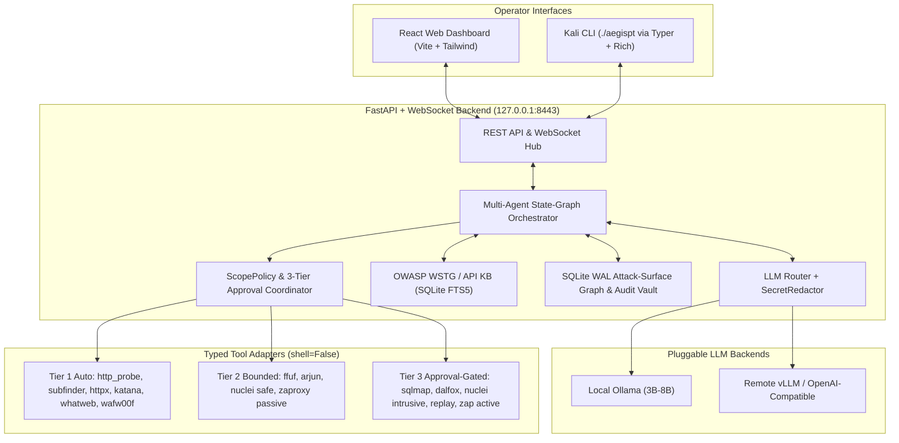
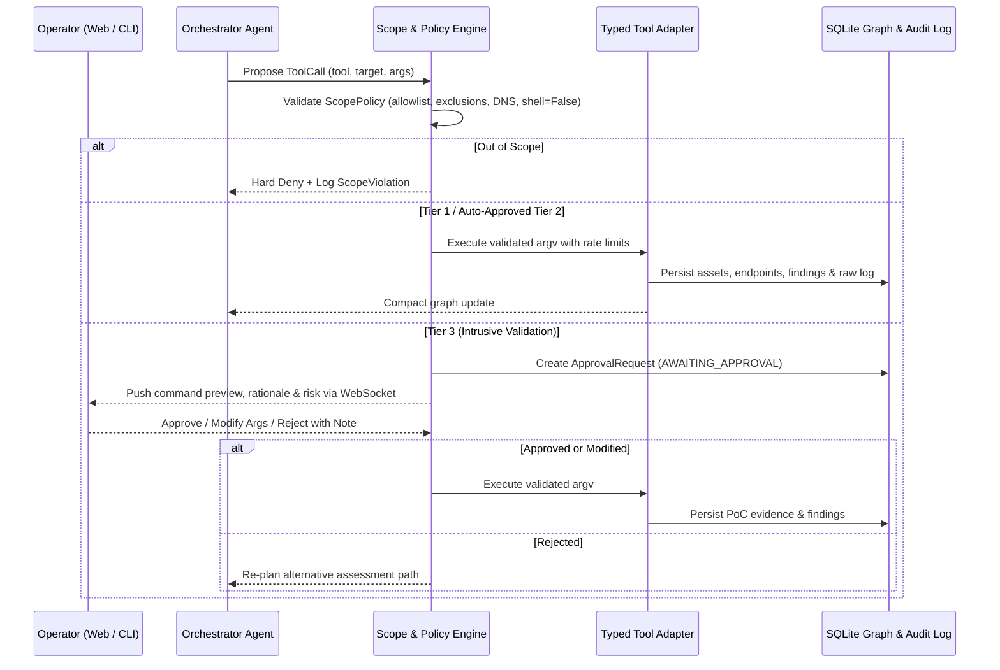

<div align="center">

# AegisPT

### Private, Provider-Agnostic AI Web & API Penetration Testing Platform

Built for Kali Linux with allowlist-only scope enforcement, 3-tier human-in-the-loop approval gates, 12 typed security tool adapters, and a real-time Web Dashboard + CLI.

[](https://www.python.org/)
[](https://fastapi.tiangolo.com/)
[](https://react.dev/)
[](https://www.kali.org/)
[](./aegispt/backend/tests)

[Architecture](#architecture) •
[Autonomy & Guardrails](#autonomy--safety-guardrails) •
[Tooling Matrix](#3-tier-tooling-matrix) •
[Quick Start](#quick-start) •
[API & Config](#configuration--api-reference) •
[Testing](#running-tests)

</div>

---

## Why AegisPT?

| Pillar | What It Does |
| :--- | :--- |
| **Private & Localhost-First** | FastAPI + WebSocket backend binds strictly to `127.0.0.1:8443` with bearer token auth (`data/.api_token`) and local SQLite (WAL) persistence—zero telemetry leaves your machine. |
| **Provider-Agnostic LLM Router** | Hot-swap between local **Ollama** (`/api/chat`) and remote **vLLM / OpenAI-compatible** (`/v1/chat/completions`) endpoints with `fast` + `reasoning` tiers and automatic reversible secret/JWT/cookie redaction on non-local calls. |
| **Offline OWASP Playbook Fallback** | Built-in **SQLite FTS5** OWASP WSTG & API Top 10 knowledge base powers a deterministic fallback planner whenever no LLM server is running. |
| **Non-Bypassable Scope Engine** | Default-deny `ScopePolicy` enforces allowlisted domains, URLs, and CIDRs, host/path exclusions, DNS resolution boundaries, rate limits (`max_rps`, `max_concurrency`), and `shell=False` typed `argv` compilation. |
| **Dual Operator Experience** | Operate from the **React Web Dashboard** (Attack-Surface Graph, live stream, interactive Tier-3 approval modal, evidence viewer) or the **Typer + Rich Kali CLI** (`./aegispt`). |
| **Developer-Ready Reporting** | One-click exports in **HTML**, **Markdown**, **SARIF 2.1.0**, and **JSON** with CVSS v3.1 scores, CWE/OWASP tags, PoC commands, and remediation guidance. |

---

## Architecture



---

## Autonomy & Safety Guardrails

AegisPT supports three operator-selectable execution modes per engagement:

- **`tiered`** *(Default)* — Runs Tier 1 recon and bounded Tier 2 scans automatically; pauses and prompts the operator (Web modal or CLI `[a]pprove / [e]dit / [r]eject`) before every Tier 3 intrusive action.
- **`copilot`** — Prompts operator approval before every tool execution across all tiers.
- **`lab_autopilot`** — Unattended end-to-end execution strictly for isolated localhost/Docker practice labs.



---

## 3-Tier Tooling Matrix

| Tool | Default Tier | Escalation Rule | Capability |
| :--- | :---: | :--- | :--- |
| `http_probe` | **Tier 1** | Tier 3 on `replay_request` or mutating HTTP methods | Native async HTTP/TLS/header/CORS/cookie audit & OpenAPI/Swagger/GraphQL discovery |
| `subfinder` | **Tier 1** | — | Passive subdomain enumeration |
| `httpx` | **Tier 1** | — | Live HTTP probing (ProjectDiscovery `httpx` with automatic native `http_probe` fallback) |
| `katana` | **Tier 1** | — | Web & JavaScript route/parameter crawling |
| `whatweb` | **Tier 1** | — | Server, CMS, and framework fingerprinting |
| `wafw00f` | **Tier 1** | — | WAF / CDN detection |
| `ffuf` | **Tier 2** | Configurable (`tier2_auto`) | Rate-limited directory & API discovery with auto-calibration |
| `arjun` | **Tier 2** | Configurable (`tier2_auto`) | HTTP query, form, and JSON parameter mining |
| `nuclei` | **Tier 2** | Tier 3 when `include_intrusive=true` or `fuzz`/`intrusive` tags | Template scanner (Tier 2 excludes `dos,intrusive,fuzz,bruteforce`) |
| `zaproxy` | **Tier 2** | Tier 3 in `active_scan` mode | OWASP ZAP headless daemon spider/passive alerts & active scan |
| `dalfox` | **Tier 3** | Always gated in `tiered` mode | Cross-Site Scripting (XSS) parameter verification |
| `sqlmap` | **Tier 3** | Always gated in `tiered` mode | Bounded SQL injection verification (`--batch`, `level<=2`, `risk<=2`) |

---

## Quick Start

### 1. Clone & Run Diagnostics

```bash
git clone https://github.com/willygailo/AI-ko.git
cd AI-ko/aegispt
cp .env.example .env

# Verify all 12 Kali tool adapters, OWASP KB, and LLM endpoint reachability
./aegispt doctor
```

> [!TIP]
> Running on an 8 GB / CPU-only Kali machine? Use the included helper script to pull compact quantized Ollama models (`qwen2.5:3b` + `qwen2.5-coder:7b`), or attach a remote vLLM server from the Web Dashboard Settings modal.
>
> ```bash
> ./scripts/setup_ollama.sh
> ```

### 2. Start the Backend & Web Dashboard

```bash
./aegispt serve
```

- Web Dashboard & API listen on `http://127.0.0.1:8443` (serves `aegispt/frontend/dist` automatically when built).
- Copy the local API bearer token printed on startup (or retrieve it anytime with `./aegispt token`).

<details>
<summary>Frontend Build & Hot-Reload Development Commands</summary>

```bash
cd aegispt/frontend
pnpm install
pnpm build   # Outputs dist/ served directly by FastAPI on http://127.0.0.1:8443
pnpm dev     # Optional Vite dev server with API/WS proxy on http://127.0.0.1:5173
```

</details>

### 3. Try It Against the Local OWASP Juice Shop Lab

Spin up the isolated localhost-only (`127.0.0.1:3000`) practice container:

```bash
cd aegispt
docker compose -f lab/docker-compose.lab.yml up -d
```

Create a scoped engagement, stream live progress + Tier-3 approvals, and export a report:

```bash
./aegispt engagement create \
  --name "Local Juice Shop" \
  --url http://127.0.0.1:3000 \
  --allow-private-ips \
  --mode tiered

./aegispt run <ENGAGEMENT_ID>
./aegispt findings <ENGAGEMENT_ID>
./aegispt report <ENGAGEMENT_ID> --format html --out report.html
```

---

## Configuration & API Reference

<details>
<summary><strong>Repository Structure</strong></summary>

```text
.
├── .gitignore
├── README.md
└── aegispt/
    ├── aegispt                         # CLI launcher script (./aegispt)
    ├── pyproject.toml                  # Python project & entrypoint metadata
    ├── .env.example                    # Environment configuration template
    ├── backend/
    │   ├── app/
    │   │   ├── main.py                 # FastAPI app, lifespan, static frontend mount
    │   │   ├── config.py               # Pydantic settings (AEGISPT_*)
    │   │   ├── core/                   # auth, scope, policy, redactor, events
    │   │   ├── db/                     # Async SQLite (WAL) engine & ORM models
    │   │   ├── llm/                    # Ollama & OpenAI-compatible router
    │   │   ├── tools/                  # 12 typed tool adapters & registry
    │   │   ├── knowledge/              # SQLite FTS5 OWASP WSTG/API playbooks
    │   │   ├── agents/                 # Orchestrator, graph context, HTML/MD/SARIF reporter
    │   │   └── api/                    # REST routers & WebSocket handler
    │   └── tests/                      # Unit & integration test suite (19 tests)
    ├── cli/aegispt_cli/                # Typer + Rich CLI client
    ├── frontend/                       # React + Vite + TypeScript + Tailwind UI
    ├── lab/docker-compose.lab.yml      # Localhost-only OWASP Juice Shop practice target
    └── scripts/setup_ollama.sh         # Optional local Ollama model pull helper
```

</details>

<details>
<summary><strong>Environment Variables (<code>aegispt/.env</code>)</strong></summary>

| Variable | Default | Description |
| :--- | :--- | :--- |
| `AEGISPT_HOST` | `127.0.0.1` | Bind address for FastAPI server |
| `AEGISPT_PORT` | `8443` | HTTP / WebSocket server port |
| `AEGISPT_API_TOKEN` | _(auto-generated)_ | Fixed bearer token; if blank, stored in `data/.api_token` |
| `AEGISPT_DATA_DIR` | `./data` | Storage directory for SQLite DBs, logs, and tool artifacts |
| `AEGISPT_OLLAMA_URL` | `http://127.0.0.1:11434` | Local Ollama endpoint |
| `AEGISPT_OLLAMA_FAST_MODEL` | `qwen2.5:3b` | Fast parser / extraction model |
| `AEGISPT_OLLAMA_REASONING_MODEL` | `qwen2.5-coder:7b` | Primary planning & triage model |
| `AEGISPT_REMOTE_LLM_URL` | `""` | Optional remote OpenAI-compatible / vLLM endpoint |
| `AEGISPT_REMOTE_LLM_API_KEY` | `""` | Bearer API key for remote LLM endpoint |
| `AEGISPT_REDACT_OUTBOUND` | `true` | Masks tokens, cookies, and JWTs before remote LLM calls |
| `AEGISPT_ZAP_URL` | `http://127.0.0.1:8080` | Optional OWASP ZAP headless daemon API URL |
| `AEGISPT_DEFAULT_TOOL_TIMEOUT` | `180` | Subprocess execution timeout (seconds) |
| `AEGISPT_DEFAULT_MAX_STEPS` | `25` | Default maximum orchestrator iterations |

</details>

<details>
<summary><strong>REST & WebSocket Endpoints</strong></summary>

All `/api/v1/*` routes (except `/api/v1/system/health`) require `Authorization: Bearer <token>`:

| Group | Endpoints |
| :--- | :--- |
| **System & KB** | `GET /api/v1/system/health`, `GET /api/v1/system/doctor`, `GET /api/v1/system/tools`, `GET /api/v1/system/kb/search` |
| **LLM Profiles** | `GET/POST /api/v1/llm-profiles`, `DELETE /api/v1/llm-profiles/{id}`, `POST /api/v1/llm-profiles/discover` |
| **Engagements** | `GET/POST /api/v1/engagements`, `GET/DELETE /api/v1/engagements/{id}`, `POST /api/v1/engagements/{id}/{start\|pause\|resume\|stop\|run-tool}`, `GET /api/v1/engagements/{id}/runs/{run_id}/log` |
| **Approvals & Findings** | `GET /api/v1/engagements/{id}/approvals`, `POST /api/v1/approvals/{approval_id}/decide`, `GET /api/v1/engagements/{id}/findings`, `PATCH /api/v1/findings/{finding_id}` |
| **Reports & Stream** | `GET /api/v1/engagements/{id}/report?format=html\|markdown\|sarif\|json`, `WS /ws/engagements/{id}?token=<token>` |

</details>

---

## Running Tests

```bash
cd aegispt
PYTHONPATH=backend:cli pytest -v backend/tests
```

Covers scope allowlists & DNS boundary checks, 3-tier approval workflows, tool output parsers, LLM routing + secret redaction, REST/WebSocket integration, and end-to-end orchestrator runs.

---

> [!WARNING]
> **Authorized Use Only**: AegisPT is intended strictly for authorized security assessments, defensive hardening, and isolated lab testing. Always obtain explicit written authorization and configure strict scope allowlists before testing any system.
